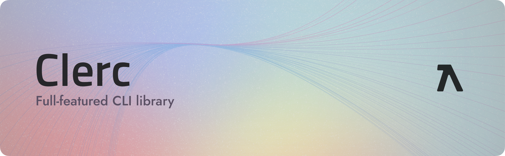

<p align="center">
  <a target="_blank" href="https://clerc.so1ve.dev" noreferrer noopener>Clerc</a> is a modern, strongly-typed CLI framework for Node.js 26+.
</p>

<div align="center">

[](https://npmjs.org/package/clerc)
[](https://github.com/clercjs/clerc/actions/workflows/conventional-ci.yml)
[](https://npmjs.org/package/clerc)
[](https://github.com/clercjs/clerc/blob/main/package.json)

</div>

<hr/>

> [!NOTE]
> ESM-only, targeting Node.js >= 26.

# ✨ Features

- **Route-Style Typed Command Signatures** — Write `"deploy <target> [region] -- [extra...]"` and get full template-literal inference + `args` key autocompletion with zero `as const`.
- **Batteries-Included Core** — Native `--help`, `--version`, strict unknown-flag checks with typo suggestions, and Cargo/Clap-inspired diagnostics (plus JSON mode) right out of the box.
- **Unified `Clerc` & `plugin()` Primitives** — Plugins and apps share the exact same clean verbs (`.flags()`, `.groups()`, `.command()`, `.extend()`, `.middleware()`, `.onError()`, `.use()`), with async context derivation after flag resolution and atomic named overrides.
- **Standard Schema v1** — Use Zod, Valibot, ArkType, or built-in `Types` directly for flags and arguments, with `env` fallbacks, `conflicts`, and `implies`.
- **Testable by Design** — Pure per-invocation `cli.run(argv, { terminal })` with `createMemoryTerminal()`, zero `process.exit()` side effects.

# 😊 Quick Start

```ts
import { Types, clerc } from "clerc";

const cli = clerc({
  name: "acme",
  version: "2.0.0",
  description: "Build and deploy modern TypeScript apps",
});

cli.command("deploy <target> [region]", {
  description: "Deploy application to target environment",
  args: {
    target: {
      type: Types.Enum("staging", "prod"),
      description: "Target environment",
    },
  },
  flags: {
    port: {
      type: Number,
      short: "p",
      default: 3000,
      env: "PORT",
      description: "Server port",
    },
    dryRun: {
      type: Boolean,
      short: "n",
      description: "Preview without deploying",
    },
  },
  run(ctx) {
    ctx.log.step(`Deploying to ${ctx.args.target} on port ${ctx.flags.port}`);
    if (ctx.flags.dryRun) {
      ctx.log.info("Dry run enabled, no changes applied.");
    } else {
      ctx.log.success("Deployed!");
    }
  },
});

await cli.runMain();
```

# 📦 Packages

- `clerc` — Core CLI framework: POSIX argv parser, `clerc`, `plugin`, layered help & diagnostics, Standard Schema v1, `Terminal`, `Theme`, and first-party plugins (`verbosityPlugin`, `updateNotifierPlugin`).
- `@clerc/theme` — Zero-dependency semantic CLI theme and terminal capability detection.
- `@clerc/logger` — Minimal CLI logger with aligned word labels and JSON mode.
- `@clerc/plugin-completions` — Shell completion generator powered by `@bomb.sh/tab`.
- `@clerc/plugin-mcp` — Zero-dependency MCP stdio server exposing CLI commands as tools and help pages as resources.

# 📖 Documentation

Please see https://clerc.so1ve.dev.

# 🦄 Examples

- [Greeting](./examples/greeting)
- [Bumpp](./examples/bumpp)

# 📝 License

[MIT](./LICENSE). Made with ❤️ by [Ray](https://github.com/so1ve)
